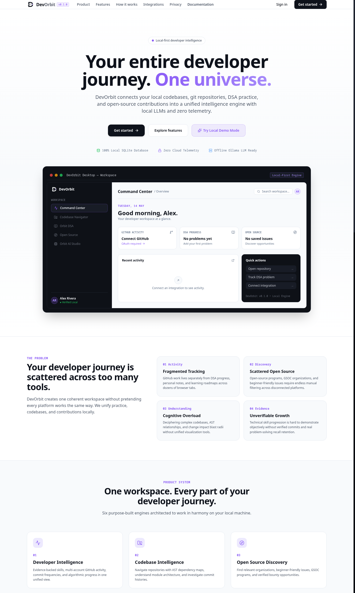
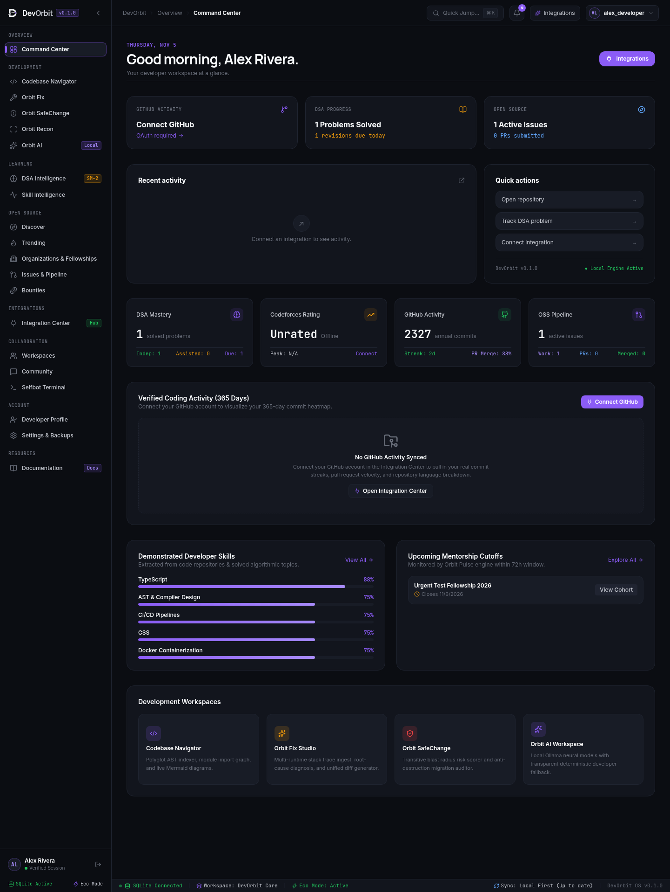
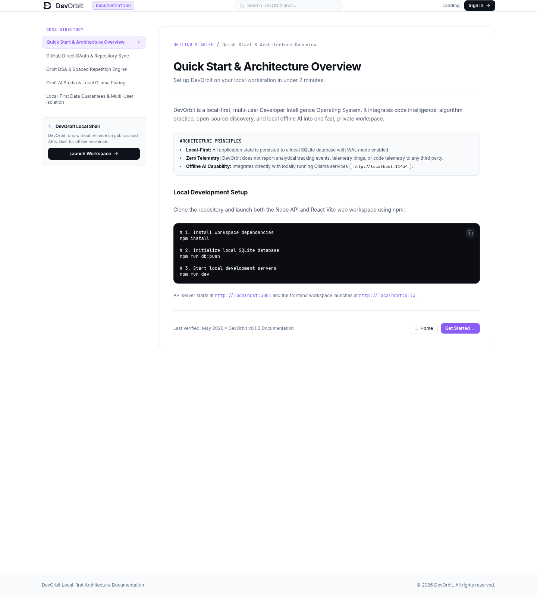

# DevOrbit
> **Your Skills. Your Code. Your Opportunities. One Universe.**

[](https://opensource.org/licenses/MIT)
[](https://nodejs.org/)
[](https://www.typescriptlang.org/)
[](https://react.dev/)
[-003B57.svg)](https://sqlite.org/)
[](./docs/release/FIGMA_IMPLEMENTATION_REPORT.md)

---

## 1. Product Overview

**DevOrbit** is a local-first, privacy-respecting **Developer Intelligence Platform**. It connects fragmented developer data—source code repositories, competitive programming handles, algorithmic revision schedules, multi-platform open-source discovery, and evidence-grounded recommendations—into a single, unified, space-themed command center.

Unlike cloud dashboards that sell user metrics or lock workflows behind recurring SaaS fees, DevOrbit is 100% locally owned. All data resides in an encrypted SQLite database on your local machine, and AI assistance runs completely on-device via [Ollama](https://ollama.ai) with zero cloud telemetry.

---

## 2. Key Capabilities & Innovations

### 🔍 Multi-Platform Open Source Organization Discovery
DevOrbit provides a normalized multi-platform discovery architecture supporting top global open-source ecosystems:
- **Google Summer of Code (GSoC)**: 600+ organizations with historical topic indexing and project counts.
- **Outreachy Mentorship**: Verified diversity-focused open-source internships (Mozilla, Wikimedia, GNOME, Tor, Wagtail, Oppia).
- **Linux Foundation (LFX Mentorship)**: Kernel, cloud native, and infrastructure mentorships (CNCF, Hyperledger, OpenSSF, Zephyr, GraphQL Foundation).
- **Major League Hacking (MLH Fellowship)**: Production open-source fellowships (Meta Open Source, Pallets, Solana, Julia Language).
- **GitHub Open Source**: Direct ecosystem leaders (Vercel, Supabase, Tailwind Labs, Bun, Prisma).

Features:
- Multi-platform selection filter with combined OR / AND logic.
- Technology filters with active count badges.
- Organization detail modal accessible via card click, showing verified website URLs, platform history, and open beginner issues.
- URL Query Parameter synchronization (`?platforms=...&techs=...&techLogic=...&search=...&org=...`) preserving exact filter state across browser refreshes and shareable bookmarks.

### 🎯 7-Factor Explainable Recommendation Engine
DevOrbit replaces opaque heuristics with a deterministic, explainable 7-factor scoring engine:
1. **Technology Match (25%)**: Overlap between candidate project stack and developer's verified codebase languages.
2. **Domain Relevance (20%)**: Architectural domain fit (Systems, Web, Cloud Native, DevOps, AI).
3. **Difficulty Alignment (15%)**: Calibrated to developer's stated experience level (`BEGINNER`, `INTERMEDIATE`, `ADVANCED`).
4. **Skill Strength Match (15%)**: Confidence weighting derived from multi-repository AST evidence.
5. **Project Health (10%)**: Star counts, active issues, verified maintenance indicators.
6. **Issue Freshness (10%)**: Creation recency and active conversation activity.
7. **Organization Relevance (5%)**: Mentorship platform provenance and foundation backing.

Every recommendation includes:
- **Category Classification**: `BEST_SKILL_FIT`, `GOOD_FIRST_ISSUE`, `DOMAIN_EXPANSION`, `TRENDING_HOT`, `SPONSORED_BOUNTY`.
- **Transparent Explanation**: Formatted reason text detailing the exact match provenance.
- **Feedback Loop**: "Save", "Track", and "Dismiss" buttons; dismissing adjusts future interest weights deterministically.

### 🧠 Unified Developer Intelligence Profile & README Signal Extraction
- **README Signal Extractor**: Ingests `<user>/<user>` profile README and repository READMEs, parsing tech stack shields/badges, declared languages, frameworks, databases, and focus areas.
- **Multi-Source Skill Aggregation**: Unifies GitHub code AST metrics, README signals, competitive handles, and manual calibrations with provenance tags (`GITHUB_CODEBASE`, `GITHUB_README`, `MANUAL_VERIFIED`).
- **Editable Opportunity Preferences**: Real-time configuration of primary focus, experience level, bio, and weekly availability commitment hours.

### 🛡️ Enterprise Security & OAuth Replay Defense
- **Atomic OAuth State Verification**: Single-use SHA-256 hashed state tokens preventing OAuth CSRF and replay attacks.
- **AES-256-GCM Cryptographic Vault**: Integration secrets (GitHub PATs, OAuth credentials) encrypted with authenticated AES-256-GCM.
- **Content-Type Protected API Client (`apiFetch`)**: Centralized response parser preventing unexpected HTML error crashes (`<!DOCTYPE ...`) when proxies or services return non-JSON responses.

---

## 3. Product Visual Walkthrough

DevOrbit's UI is designed strictly against the official Figma brand identity (*Workspace Canvas* `#F9FAFB`, *Cards* `#FFFFFF` with `border border-black/7`, *Electric Violet* `#8B5CF6`, *Signal Gray* `#686D79`, and *Dark Code Editors* `#11141B`).

### Public Landing Page (Figma Reference Canvas)

*Faithful implementation of all 11 Figma sections: Light hero, 4 numbered cards, intelligence tabs, integration grid, and Electric Violet CTA.*

### Command Center (Authenticated Workspace)

*Date banner in Electric Violet (`THURSDAY, NOV 5`), 3 core summary cards (GitHub, DSA, OSS), recent activity log, and quick actions card.*

### Documentation Hub (Preview Route `/documentation`)

*Clean two-column technical docs, category sidebar, breadcrumb hierarchy, copyable shell blocks, and local API reference.*

---

## 4. Key Modules

| Module | Core Capabilities |
|---|---|
| **Command Center** | Unified developer HUD, 365-day verified coding heatmap, active OSS pipeline, SM-2 daily revision queue. |
| **Organization Discovery** | Multi-platform discovery across GSoC, Outreachy, LFX Mentorship, MLH, and GitHub Open Source. |
| **Recommendation Engine** | 7-factor explainable matching with categories, transparent evidence text, and feedback loop. |
| **Developer Profile** | Unified intelligence profile with README badge extraction and multi-source skill calibration. |
| **Integration Center** | Real connections for GitHub (OAuth/PAT), Codeforces (live REST), LeetCode, TUF Striver A2Z, and Ollama. |
| **DSA Intelligence** | 455+ problem tracking, cognitive mastery classification, and SuperMemo SM-2 spaced repetition scheduling. |
| **Orbit AI Studio** | 100% on-device neural assistant powered by Ollama (`deepseek-coder`, `qwen2.5-coder`). Honest deterministic rule engine fallback when offline. |
| **Disaster Recovery** | Single-click full JSON export and restore for database backups and account portability. |

---

## 5. Architecture Overview

```mermaid
flowchart TD
    subgraph Client ["Client Layer (Web & Desktop)"]
        UI["React 19 + Tailwind CSS + Lucide"]
        Shell["Figma Nav Shell + Filter Query Sync"]
        Modal["Slide-over Organization & Match Modals"]
    end

    subgraph Server ["DevOrbit Local API (:3001)"]
        Express["Express API Server (TypeScript)"]
        AuthGuards["JWT + RBAC + Helmet Security"]
        CryptoVault["AES-256-GCM Cryptographic Vault"]
        
        subgraph Providers ["Multi-Platform Providers"]
            GSOC["GSoC 2026 Provider (606 orgs)"]
            OUTREACHY["Outreachy Provider"]
            LFX["Linux Foundation LFX Provider"]
            MLH["MLH Fellowship Provider"]
            GH_OSS["GitHub Open Source Provider"]
        end

        subgraph CoreEngines ["Intelligence Engines"]
            RecEngine["7-Factor Explainable Recommendation Engine"]
            ReadmeExtractor["README Signal Extraction Engine"]
            SM2["SuperMemo SM-2 Spaced Repetition Engine"]
            Normalizer["Canonical Repository Normalizer"]
        end
    end

    subgraph Storage ["Local Storage & Offline AI"]
        Prisma["Prisma ORM 6.4"]
        SQLite[("Local SQLite Database (devorbit.db)")]
        LocalLLM["Local Ollama Daemon (127.0.0.1:11434)"]
    end

    UI -->|HTTP / JSON (apiFetch)| Express
    Express --> AuthGuards
    AuthGuards --> CryptoVault
    Express --> CoreEngines
    CoreEngines --> Providers
    CoreEngines --> Prisma
    Prisma --> SQLite
    Express -.->|Optional Local AI| LocalLLM
```

---

## 6. Technology Stack

- **Frontend**: React 19, TypeScript, Vite 6, Tailwind CSS 3.4, Lucide Icons, Recharts.
- **Backend API**: Node.js 22, Express 4.21, TypeScript 5.7, Zod input validation, Helmet, CORS.
- **Database**: SQLite with Prisma ORM 6.4 (32 relational models, WAL mode).
- **Security**: AES-256-GCM token encryption, bcryptjs password hashing, atomic SHA-256 OAuth replay defense.
- **AI Runtime**: Local Ollama daemon via native HTTP streaming (`deepseek-coder`, `qwen2.5-coder`).
- **Testing**: Vitest 3.0, Supertest.

---

## 7. Installation & Quick Start

### 1. Prerequisites
- **Node.js**: `v20.0.0` or higher (tested on Node `v22.23.1`)
- **npm**: `v10.0.0` or higher
- **Git**: `v2.40+`

### 2. Clone Repository & Install Dependencies
```bash
git clone https://github.com/ankurgupta/DevOrbit.git
cd DevOrbit
npm install
```

### 3. Configure Environment Variables
```bash
cp .env.example .env
```
*(The defaults in `.env.example` are immediately functional for local development out of the box).*

### 4. Initialize Local SQLite Database
```bash
npm run db:push
npm run db:seed
```

### 5. Start Development Servers
Run both backend and frontend concurrently:
```bash
npm run dev
```
Or in separate terminals:
```bash
# Terminal 1: Backend API Server (Port 3001)
npm run dev:api

# Terminal 2: Web Client (Port 5173)
npm run dev:web
```

Open your browser to **`http://localhost:5173`** to access DevOrbit.

---

## 8. Verified Integrations Guide

### GitHub Connection
1. Navigate to **Integration Center** (`/integrations`).
2. Click **Connect GitHub**.
3. **Personal Access Token (PAT)**: Provide a token with `repo` and `read:user` scopes.
4. **OAuth Application**: Set `GITHUB_CLIENT_ID` and `GITHUB_CLIENT_SECRET` in `.env` to enable 1-click web authorization with atomic SHA-256 anti-replay validation.
5. All secrets are encrypted via authenticated **AES-256-GCM** before database persistence.

### Codeforces Connection
1. Go to **Integration Center** (`/integrations`).
2. Click **Connect Codeforces Handle**.
3. Enter your public Codeforces handle (e.g., `tourist`, `Petr`).
4. DevOrbit queries the live official Codeforces REST API (`user.info`, `user.rating`, `user.status`) and displays your verified rating, max rating, and contest analytics.

### LeetCode & Take U Forward (TUF)
1. Open **Integration Center** (`/integrations`).
2. Connect your handle to synchronize solved problem metrics and topic proficiencies.
3. Track your algorithmic progress across the 455-problem Striver A2Z curriculum with automated SuperMemo SM-2 spaced repetition.

### Local Ollama AI Setup
1. Install Ollama:
   ```bash
   curl -fsSL https://ollama.com/install.sh | sh
   ```
2. Pull a coding model:
   ```bash
   ollama run deepseek-coder
   ```
3. Open **Orbit AI** (`/ai`). DevOrbit will automatically discover `deepseek-coder` and enable real-time local streaming inference.

---

### Real User Authentication & Data Isolation
- **Multi-User Registration & Login**: Real accounts created with secure bcrypt-hashed passwords.
- **Session Persistence**: Dual-layer authentication supporting `httpOnly` secure cookies and `Authorization: Bearer <token>` headers.
- **Provider Ownership**: All credentials, tokens, recommendations, and DSA revisions are scoped strictly to the authenticated `userId`.
- **Zero Demo Hardcoding**: Application operates fully for real users without seeded demo fixtures.

---

## 9. Automated Test Suite

DevOrbit maintains a comprehensive test suite across API and Web verifying all architectural layers:

```bash
npm test
npm run typecheck
```

### Verification Results:
- **`@devorbit/api`**: 15 test suites passed, 106 tests passed.
- **`@devorbit/web`**: 10 test suites passed, 38 tests passed.
- **Type Checking**: Full TypeScript strict validation across workspaces (0 errors).

---

## 10. Production Build

To compile production-optimized bundles:
```bash
npm run build
```
This runs TypeScript type checking (`tsc`) and generates optimized production artifacts in `apps/web/dist` and `apps/api/dist`.

---

## 11. Security & Privacy Architecture

- **Zero Cloud Telemetry**: No third-party analytics, user tracking beacons, or telemetry scripts.
- **AES-256-GCM Token Encryption**: Integration secrets are encrypted with authenticated AES-256-GCM with unique 96-bit initialization vectors.
- **Single-Use OAuth State Verification**: High-entropy OAuth state tokens are stored as SHA-256 hashes and consumed atomically.
- **HTML Leak Protection**: Centralized response parser (`apiFetch`) guarantees structured JSON errors even if intermediate proxies return HTML.
- **IDOR Safeguards**: All user-specific database entities strictly enforce `where: { id, userId }` ownership checks.
- **Strict Figma Brand Consistency**: Strict adherence to official design tokens, eliminating emerald green brand bleed.

---

## 12. Documentation Directory

Detailed implementation guides and references are located in [`docs/`](./docs/):

- [`docs/INSTALLATION.md`](./docs/INSTALLATION.md): Complete OS-specific installation manual.
- [`docs/DEVELOPMENT.md`](./docs/DEVELOPMENT.md): Developer architecture and contributing workflow.
- [`docs/PRODUCTION_DEPLOYMENT.md`](./docs/PRODUCTION_DEPLOYMENT.md): Production deployment and systemd service setup.
- [`docs/ENVIRONMENT_VARIABLES.md`](./docs/ENVIRONMENT_VARIABLES.md): Comprehensive environment variable specification.
- [`docs/AUTHENTICATION.md`](./docs/AUTHENTICATION.md): Security model, password hashing, and token lifecycles.
- [`docs/INTEGRATIONS.md`](./docs/INTEGRATIONS.md): Deep provider architecture (GitHub, Codeforces, LeetCode, TUF).
- [`docs/AI_SETUP.md`](./docs/AI_SETUP.md): Local Ollama configuration and fallback behavior.
- [`docs/BACKUP_AND_RESTORE.md`](./docs/BACKUP_AND_RESTORE.md): Disaster recovery and data portability procedures.
- [`docs/TROUBLESHOOTING.md`](./docs/TROUBLESHOOTING.md): Solutions for common setup and runtime errors.
- [`docs/SECURITY.md`](./docs/SECURITY.md): Threat model and cryptographic implementation details.

---

## 13. License

DevOrbit is open-source software licensed under the [MIT License](LICENSE).
