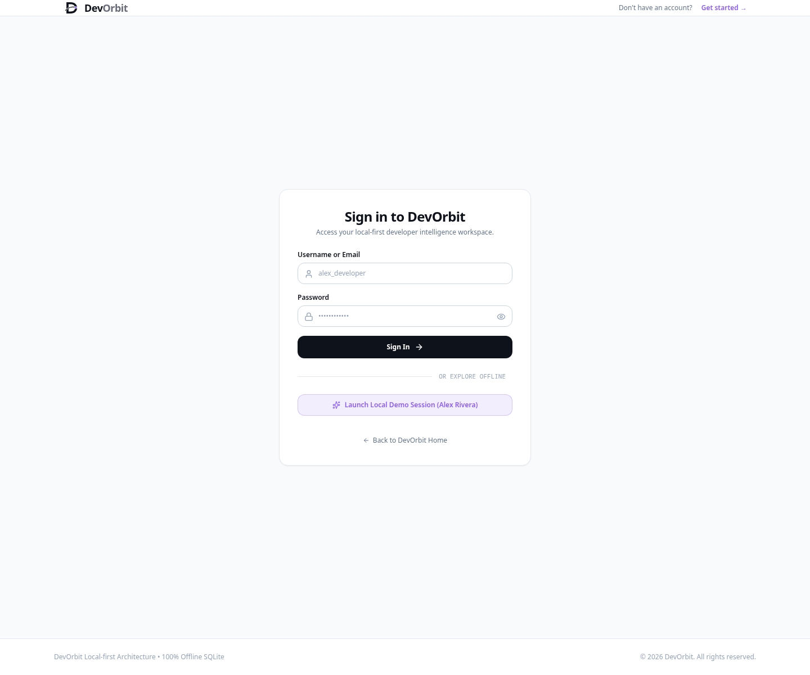
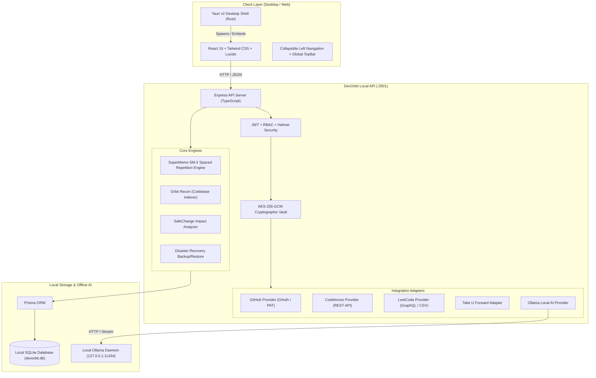

# DevOrbit
> **Your Skills. Your Code. Your Opportunities. One Universe.**

[](https://opensource.org/licenses/MIT)
[](https://nodejs.org/)
[](https://www.typescriptlang.org/)
[](https://react.dev/)
[-003B57.svg)](https://sqlite.org/)
[-success.svg)](./apps/api/src/tests/)
[](./docs/release/FIGMA_IMPLEMENTATION_REPORT.md)

---

## 1. Product Overview

**DevOrbit** is a local-first, privacy-respecting **Developer Intelligence Operating System**. It connects fragmented developer data—source code repositories, competitive programming handles, algorithmic revision schedules, open-source contribution pipelines, and local neural intelligence—into a single, unified, space-themed command center.

Unlike cloud dashboards that sell user metrics or lock workflows behind recurring SaaS fees, DevOrbit is 100% locally owned. All data resides in an encrypted SQLite database on your local machine, and AI assistance runs completely on-device via [Ollama](https://ollama.ai) with zero cloud telemetry.

---

## 2. Problem Statement

Modern software engineers suffer from extreme tool fragmentation:
1. **GitHub Activity**: Scattered across private and public repositories, organizations, and pull request threads.
2. **Algorithmic Mastery (DSA)**: Spread between LeetCode, Codeforces, and curated sheets (e.g., Striver A2Z, NeetCode 150), leading to duplicate solves, forgotten patterns, and lack of systematic spaced repetition.
3. **Open-Source Intelligence (OSS)**: Difficult discovery of matching GSoC programs, fellowship cutoffs, and legitimate issue bounties without manual curation.
4. **AI & Code Privacy**: Cloud-based coding assistants often index proprietary code bases and leak developer intellectual property.

**DevOrbit solves this** by serving as an on-device operating system that aggregates your engineering footprint, automates cognitive spaced review using SuperMemo SM-2, tracks open-source fellowships, and provides private, local AI inference.

---

## 3. Product Visual Walkthrough

DevOrbit's UI is designed strictly against the official Figma brand identity (*Orbit Black* `#0B0D12`, *Electric Violet* `#8B5CF6`, *Soft White* `#F8FAFC`, and *Signal Gray* `#686D79`), featuring responsive navigation, custom typography, and zero emerald green bleed.

### Public Landing Page (Figma Reference Canvas)

*Faithful implementation of all 11 Figma sections: Light hero, 4 numbered cards, intelligence tabs, integration grid, and Electric Violet CTA.*

### Command Center (Authenticated Workspace)

*Date banner in Electric Violet (`THURSDAY, NOV 5`), 3 core summary cards (GitHub, DSA, OSS), recent activity log, and quick actions card.*

### Documentation Hub (Preview Route `/documentation`)

*Clean two-column technical docs, category sidebar, breadcrumb hierarchy, copyable shell blocks, and local API reference.*

### Authentication & Fast Local Demo

*Secure sign-in with instant 1-click local demo authentication.*

---

## 4. Key Features

| Module | Core Capabilities |
|---|---|
| **Command Center** | Unified developer HUD, 365-day verified coding heatmap, active OSS pipeline, SM-2 daily revision queue. |
| **Integration Center** | Zero-friction connections for GitHub, Codeforces, LeetCode, TUF Striver A2Z, and Ollama with AES-256-GCM token encryption. |
| **DSA Intelligence** | 455+ problem tracking, cognitive mastery classification (`INDEPENDENT`, `WITH_HINTS`, `WITH_EDITORIAL`, `WITH_AI`), automated SuperMemo SM-2 scheduling, and cross-platform deduplication. |
| **Orbit AI Studio** | 100% on-device neural assistant powered by Ollama (`deepseek-coder`, `qwen2.5-coder`). Honest deterministic rule engine fallback when offline. |
| **Orbit Recon & Fix** | Local AST analysis, automated dead-code detection, vulnerability inspection, and non-destructive refactoring plans. |
| **Orbit SafeChange** | Semantic impact analysis calculating blast radius and confidence scores before modifying shared dependencies. |
| **Open Source Intelligence** | Real GSoC organization database, issue shortlist pipeline, verified bounty matching, and mentorship deadline tracking. |
| **Disaster Recovery** | Single-click full JSON export and restore for database backups and account portability. |

---

## 5. Architecture Overview

DevOrbit operates as an atomic local-first monorepo:



---

## 6. Technology Stack

- **Frontend**: React 19, TypeScript, Vite 6, Tailwind CSS 3.4, Radix UI primitives, Recharts, Lucide Icons.
- **Backend API**: Node.js 22, Express 4.21, TypeScript 5.7, Zod input validation, Helmet, CORS.
- **Database**: SQLite with Prisma ORM 6.4 (26 relational models, WAL mode).
- **Security**: AES-256-GCM token encryption, bcryptjs password hashing, JWT with UUID `jti` replay mitigation.
- **Desktop Packaging**: Tauri v2 (Rust).
- **AI Runtime**: Local Ollama daemon via native HTTP streaming (`deepseek-coder`, `qwen2.5-coder`).
- **Testing**: Vitest 3.0, Supertest.

---

## 7. Prerequisites

Before running DevOrbit, ensure the following are installed:
- **Node.js**: `v20.0.0` or higher (verified on Node `v22.23.1`)
- **npm**: `v10.0.0` or higher
- **Git**: `v2.40+`
- *(Optional for AI)* **Ollama**: [Download Ollama](https://ollama.ai) for local neural intelligence.
- *(Optional for Desktop Packaging)* **Rust & Cargo**: `v1.75+` for Tauri v2 desktop bundles.

---

## 8. Installation & Setup

### 1. Clone Repository & Install Dependencies
```bash
git clone https://github.com/ankurgupta/DevOrbit.git
cd DevOrbit
npm install
```

### 2. Configure Environment Variables
```bash
cp .env.example .env
```
*(The defaults in `.env.example` are immediately functional for local development out of the box).*

### 3. Initialize & Seed Local SQLite Database
```bash
npm run db:push
npm run db:seed
```
This generates the Prisma client, establishes relational SQLite tables in `apps/api/devorbit.db`, and seeds initial algorithmic problems and open-source data.

### 4. Start Development Servers
Run both backend and frontend concurrently:
```bash
npm run dev
```
Or start them in separate terminals:
```bash
# Terminal 1: Backend API Server (Port 3001)
npm run dev:api

# Terminal 2: Web Client (Port 5173)
npm run dev:web
```

Open your browser to **`http://localhost:5173`** to access the DevOrbit Command Center.

---

## 9. Integrations Guide

### GitHub Connection
1. Navigate to **Integration Center** (`/integrations`).
2. Click **Connect GitHub**.
3. **Personal Access Token (PAT)**: Generate a token on [GitHub Settings > Tokens](https://github.com/settings/tokens) with `repo` and `read:user` scopes, paste it, and click Save.
4. **OAuth Application (Optional)**: Set `GITHUB_CLIENT_ID` and `GITHUB_CLIENT_SECRET` in `.env` to enable 1-click web authorization.
5. All tokens are encrypted using authenticated **AES-256-GCM** before being saved to SQLite.

### Codeforces Connection
1. Go to **Integration Center** (`/integrations`).
2. Click **Connect Codeforces Handle**.
3. Enter your public Codeforces handle (e.g., `tourist`, `Petr`).
4. DevOrbit will query the official live Codeforces REST API (`user.info`, `user.rating`, `user.status`) and display your current rating, peak rating, and contest analytics. No secret credentials required.

### LeetCode & Take U Forward Progress
1. Open **Integration Center** (`/integrations`).
2. Connect or update your handle to fetch problem counts and topic breakdowns.
3. Import Striver A2Z sheet progress to track your algorithmic progress against the 455-problem curriculum.

### Local Ollama AI Setup
1. Install Ollama:
   ```bash
   curl -fsSL https://ollama.com/install.sh | sh
   ```
2. Pull a coding model:
   ```bash
   ollama run deepseek-coder
   ```
3. Open **Orbit AI** (`/ai`). DevOrbit will automatically discover `deepseek-coder` and enable real-time local streaming inference.

---

## 10. Automated Test Suite

DevOrbit includes **91 automated integration and unit tests** (82 API + 9 Web) covering multi-user isolation, SuperMemo SM-2 calculations, token encryption, API validation, disaster recovery backups, rate limiting, and external provider adapters:

```bash
npm test
```

### Verification Output:
```text
Test Files  13 passed (13)
     Tests  91 passed (91)
  Duration  ~13.2s
```

---

## 11. Production Build & Desktop Packaging

### Production Web & API Build
```bash
npm run build
```
Generates optimized frontend bundles in `apps/web/dist` and compiled server code in `apps/api/dist`.

### Tauri Desktop Packaging
To compile a native desktop application bundle for Linux/macOS/Windows:
```bash
cd src-tauri
cargo build --release
```

---

## 12. Backup & Disaster Recovery

DevOrbit provides native disaster recovery without vendor lock-in:
1. Navigate to **Settings > Backups & Restore** (`/settings`).
2. Click **Export Backup JSON** to download a complete cryptographic export of your account profile, solved problems, SM-2 intervals, and bookmarks.
3. To recover, click **Choose Backup File** and upload your JSON backup to restore all progress instantly.

Alternatively, execute the backup endpoint directly via CLI:
```bash
curl -H "Authorization: Bearer <YOUR_JWT_TOKEN>" http://localhost:3001/api/v1/system/backup -o devorbit_backup.json
```

---

## 13. Security & Privacy Architecture

- **Zero Cloud Leakage**: No telemetry, tracking beacons, or analytics scripts.
- **AES-256-GCM Token Storage**: Integration secrets (GitHub PATs, OAuth tokens) are encrypted with AES-256-GCM with unique 96-bit initialization vectors.
- **Session Protection**: JWTs include high-entropy UUID `jti` claims and are verified on all protected API routes. Session invalidation is enforced immediately upon logout.
- **IDOR Prevention**: All user-specific database entities strictly enforce `where: { id, userId }` or workspace membership checks.
- **Production Safeguards**: Refuses to launch in production if `JWT_SECRET` is weak/default or `CORS_ORIGIN` is wildcard (`*`).
- **Rate Limiting**: Sliding-window rate limiters defend against brute force and resource exhaustion on auth, sync, and AI inference.
- **Secure Headers**: Express is hardened with `helmet()` middleware protecting against MIME sniffing, clickjacking, and XSS.

---

## 14. Documentation Directory

Detailed implementation guides and references are located in [`docs/`](./docs/):

- [`docs/audits/SECURITY_REMEDIATION_REPORT.md`](./docs/audits/SECURITY_REMEDIATION_REPORT.md): Security vulnerability remediations and hardening audit.
- [`docs/audits/FUNCTIONAL_VERIFICATION_REPORT.md`](./docs/audits/FUNCTIONAL_VERIFICATION_REPORT.md): Verified behavior of all 11 core functional modules.
- [`docs/release/FIGMA_IMPLEMENTATION_REPORT.md`](./docs/release/FIGMA_IMPLEMENTATION_REPORT.md): Side-by-side Figma brand identity visual alignment report.
- [`docs/INSTALLATION.md`](./docs/INSTALLATION.md): Complete OS-specific installation manual.
- [`docs/DEVELOPMENT.md`](./docs/DEVELOPMENT.md): Developer architecture and contributing workflow.
- [`docs/PRODUCTION_DEPLOYMENT.md`](./docs/PRODUCTION_DEPLOYMENT.md): Production deployment and systemd service setup.
- [`docs/ENVIRONMENT_VARIABLES.md`](./docs/ENVIRONMENT_VARIABLES.md): Comprehensive environment variable specification.
- [`docs/AUTHENTICATION.md`](./docs/AUTHENTICATION.md): Security model, password hashing, and token lifecycles.
- [`docs/INTEGRATIONS.md`](./docs/INTEGRATIONS.md): Deep provider architecture (GitHub, Codeforces, LeetCode, TUF).
- [`docs/AI_SETUP.md`](./docs/AI_SETUP.md): Local Ollama configuration and fallback behavior.
- [`docs/BACKUP_AND_RESTORE.md`](./docs/BACKUP_AND_RESTORE.md): Disaster recovery and data portability procedures.
- [`docs/TROUBLESHOOTING.md`](./docs/TROUBLESHOOTING.md): Solutions for common setup and runtime errors.
- [`docs/SECURITY.md`](./docs/SECURITY.md): Threat model and cryptographic implementation details.
- [`docs/RELEASE_CHECKLIST.md`](./docs/RELEASE_CHECKLIST.md): Quality assurance criteria and release gate checklist.
- [`docs/release/M9_FINAL_ACCEPTANCE_REPORT.md`](./docs/release/M9_FINAL_ACCEPTANCE_REPORT.md): Milestone M9 final acceptance and verification report.

---

## 15. License

DevOrbit is open-source software licensed under the [MIT License](LICENSE).
