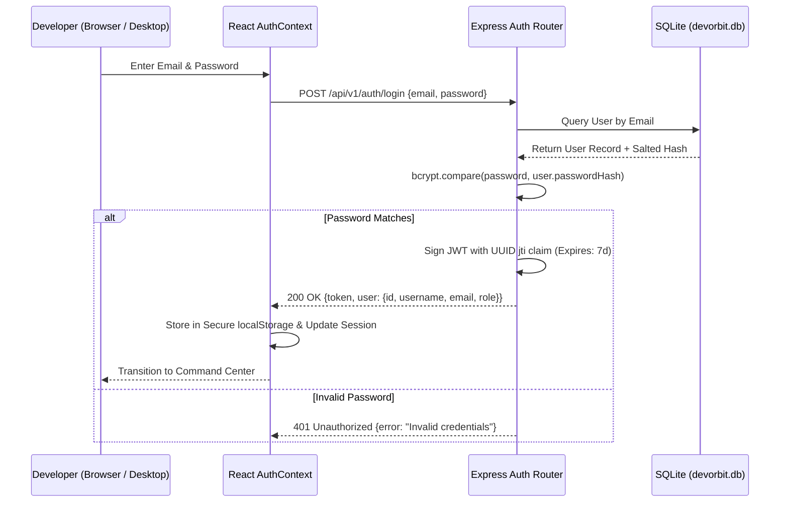

# DevOrbit — Authentication & Security Architecture

DevOrbit implements a local-first, multi-user authentication system designed for privacy, strong password cryptography, and secure session management.

---

## 1. Authentication Lifecycle



---

## 2. Password Cryptography

All user passwords are encrypted using **bcryptjs** with an adaptive work factor (salt rounds: 10):
- Passwords are never stored in plaintext.
- Rainbow table attacks are mitigated by unique per-user salts.
- Password hashes are excluded from all API response payloads via TypeScript mapping functions.

---

## 3. JWT Token Architecture & Claims

Authentication tokens are standard signed JSON Web Tokens (JWT) containing:
- `sub`: User ID (UUIDv4)
- `email`: User Email address
- `role`: Role-based access control level (`USER` or `ADMIN`)
- `jti`: Unique UUIDv4 token identifier (prevents collision attacks)
- `iat`: Issued At timestamp
- `exp`: Expiration timestamp (7 days default)

### Bearer Token & httpOnly Cookie Verification Guards
Protected API routes pass through the `authenticateToken` middleware (`apps/api/src/middleware/auth.middleware.ts`). The guard inspects credentials with dual-mode fallback:
1. **httpOnly Session Cookie**: Inspects `req.cookies.devorbit_token`, set with `httpOnly: true`, `sameSite: 'lax'`, and `secure: process.env.NODE_ENV === 'production'`.
2. **Authorization Header**: Inspects `req.headers['authorization']` (`Bearer <token>`) for headless CLI or third-party client integrations.

```typescript
const token = req.cookies?.devorbit_token || 
  (req.headers['authorization'] && req.headers['authorization'].split(' ')[1]);
// Verifies cryptographic signature against JWT_SECRET
```
If a token is expired, tampered with, or malformed, the API responds with HTTP 401 or 403.

---

## 4. Multi-User Account & Workspace Isolation

DevOrbit supports multiple independent user accounts on the same machine:
- Database entities (`UserProblem`, `IntegrationCredential`, `UserBookmark`, `Conversation`) enforce strict foreign key constraints referencing `userId`.
- All read, write, update, and delete queries verify ownership:
  ```typescript
  where: { id: conversationId, userId: req.user.id }
  ```
- Cross-account access attempts are immediately rejected, preventing Insecure Direct Object References (IDOR).
