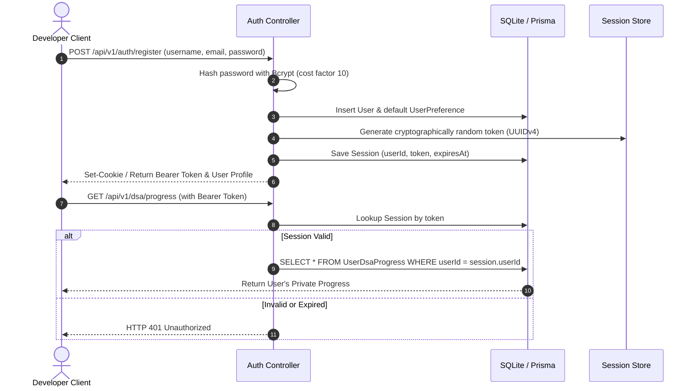

# DevOrbit — Multi-User Architecture & Security Specification

This document details the mandatory multi-user design, data isolation guarantees, workspace collaboration, and role-based access control (RBAC).

---

## 1. Multi-User Guiding Principles

1. **Zero Hardcoded User Assumptions**:
   - The application does not assume single-user or two-user configurations.
   - Any number of independent users can register, authenticate, and configure private developer profiles on the same local installation.
2. **Backend Enforcement**:
   - Data isolation is strictly enforced at the database query and service layer (`WHERE userId = ?`). Frontend filtering is never relied upon for access control.
3. **Clean Partitioning of Public vs Private Data**:
   - Public open-source intelligence (repositories, GSoC orgs, issues, DSA problem catalogs) is globally cached and shared across all users to conserve disk space and bandwidth.
   - User progress, bookmarks, private notes, API keys, AI conversations, and skill matrices are strictly isolated to the owning `userId`.

---

## 2. Authentication & Session Flow

---

## 3. Shared Workspaces & RBAC

Users can collaborate by creating **Workspaces** and inviting other registered users:

### 3.1 Roles and Permissions Matrix

| Permission | Owner | Admin | Member | Viewer |
|---|---|---|---|---|
| Delete Workspace | Yes | No | No | No |
| Change Workspace Settings | Yes | Yes | No | No |
| Invite / Remove Members | Yes | Yes | No | No |
| Change Member Roles | Yes | Yes (except Owner) | No | No |
| Create Shared Projects & Notes | Yes | Yes | Yes | No |
| Read Shared Opportunities & Timelines | Yes | Yes | Yes | Yes |
| View Private Member DSA Progress | No | No | No | No |

### 3.2 Privacy Invariants
- An Admin or Owner of a shared workspace **cannot** access a member's private DSA history, personal bookmarks, or private AI chats.
- Workspace sharing is opt-in for specific resources (e.g. sharing an issue to a workspace discussion board).
