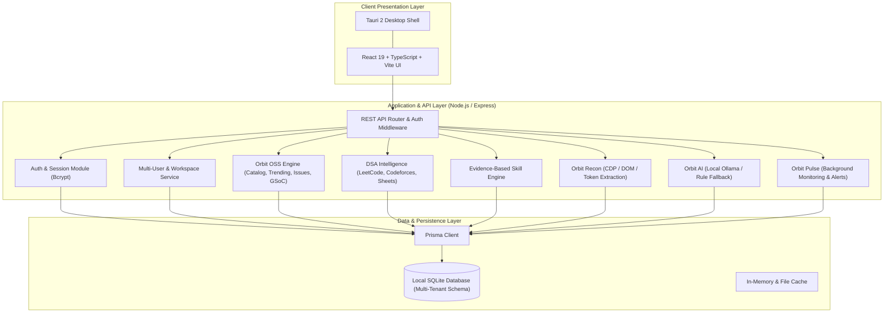

# DevOrbit — System Architecture

**Tagline**: Your Skills. Your Code. Your Opportunities. One Universe.
**Category**: Local-first, multi-user Developer Intelligence Operating System.

---

## 1. High-Level Architecture Overview

DevOrbit is designed as a modular, local-first application providing developer intelligence, algorithmic problem tracking, open-source intelligence, UI reverse-engineering reconnaissance, and AI assistance.

---

## 2. Component Subsystems

### 2.1 Presentation Subsystem (`apps/web`)
- **Framework**: React 19 with TypeScript, bundled by Vite.
- **Styling**: Tailwind CSS configured with custom DevOrbit tokens (`#0E0F10` deep canvas, `#181819` surfaces, `#09AE5B` emerald accent).
- **Navigation**: Dual-mode navigation: desktop mega-menus inspired by technical workstation interfaces, persistent sidebar for workspace apps, and fast command palette (`Cmd+K`).
- **Data Fetching**: Typed API clients with optimistic UI updates and zero waterfall cascades (`vercel-react-best-practices`).

### 2.2 Backend Subsystem (`apps/api`)
- **Runtime**: Node.js v24 LTS + Express + TypeScript.
- **Validation**: Strict schema validation via Zod on all inbound requests.
- **Authentication**: Salted bcrypt password hashing with cryptographically secure session tokens stored in SQLite with expiration timestamps.
- **Multi-Tenancy**: Every protected endpoint enforces user identity verification at the route handler and data repository level.

### 2.3 Persistence Subsystem (`prisma`)
- **Engine**: SQLite for zero-configuration, local-first reliability on single machines.
- **Migration Path**: Abstracted via Prisma ORM to allow seamless transition to PostgreSQL when migrating to distributed or cloud multi-tenant deployments.
- **Data Isolation**: Separation between global public catalog metadata and private user records.

### 2.4 Background Workers & Scheduling
- In-process lightweight job scheduler monitoring opportunity freshness, issue bookmarks, and spaced repetition schedules without heavy background daemons.
- Adheres to the Hardware Performance target (minimal idle CPU and low RAM consumption).
