# DevOrbit — Database Entity Relationship (ER) Diagram

This diagram visualizes the relational schema defined in `apps/api/prisma/schema.prisma` (33 Prisma models).

---

## 1. High-Level Entity-Relationship Model

```mermaid
erDiagram
    User ||--o{ Session : "authenticates"
    User ||--o| UserPreference : "configures"
    User ||--o{ IntegrationCredential : "connects"
    User ||--o{ UserGithubRepo : "synchronizes"
    User ||--o| UserContributionMetric : "aggregates"
    User ||--o{ Workspace : "owns"
    User ||--o{ WorkspaceMembership : "participates"
    Workspace ||--o{ WorkspaceMembership : "contains"
    
    User ||--o{ UserBookmark : "bookmarks"
    User ||--o{ UserDsaProgress : "tracks"
    DsaProblem ||--o{ UserDsaProgress : "evaluated_in"
    
    OssRepository ||--o{ OssIssue : "tracks"
    OssProgram ||--o{ OssOrganization : "hosts"
    User ||--o{ UserSavedOrganization : "saves"
    OssOrganization ||--o{ UserSavedOrganization : "saved_by"
    
    User ||--o{ UserSkillProfile : "possesses"
    User ||--o{ ContributionPipelineItem : "manages"
    OssIssue ||--o{ ContributionPipelineItem : "references"
    
    User ||--o{ SelfbotConfig : "automates"
    
    User ||--o{ ForumPost : "publishes"
    ForumPost ||--o{ ForumReply : "receives"
    User ||--o{ ForumReply : "posts"
    
    User ||--o{ AiConversation : "conducts"
    AiConversation ||--o{ AiMessage : "contains"
    
    User ||--o{ ReconProject : "inspects"
    User ||--o{ Notification : "receives"
    
    User ||--o| DeveloperProfile : "profiles"
    DeveloperProfile ||--o{ DeveloperSkill : "declares"
    DeveloperProfile ||--o{ DeveloperInterest : "declares"
    DeveloperProfile ||--o{ ReadmeSnapshot : "captures"
    ReadmeSnapshot ||--o{ ReadmeExtractedSignal : "extracts"
    
    User ||--o{ Recommendation : "receives"
    Recommendation ||--o{ RecommendationFeedback : "records"
```

---

## 2. Model Catalog & Primary Keys

| Domain | Model | Key Fields | Foreign Keys |
|---|---|---|---|
| **Auth & Identity** | `User` | `id` (UUID PK), `email` (UK), `username` (UK), `passwordHash`, `role` | — |
| | `Session` | `id` (PK), `token` (UK), `expiresAt` | `userId -> User.id` |
| | `UserPreference` | `id` (PK), `theme`, `ecoMode` | `userId -> User.id` (1:1) |
| **Integrations** | `IntegrationCredential` | `id` (PK), `provider`, `encryptedToken`, `scopes` | `userId -> User.id` |
| | `GithubOAuthState` | `id` (PK), `stateHash` (UK), `expiresAt` | `userId -> User.id` |
| | `UserGithubRepo` | `id` (PK), `repoName`, `fullName`, `starsCount` | `userId -> User.id` |
| | `UserContributionMetric` | `id` (PK), `totalContributions`, `heatmapJson` | `userId -> User.id` (1:1) |
| **Workspaces** | `Workspace` | `id` (PK), `slug` (UK), `name` | `ownerId -> User.id` |
| | `WorkspaceMembership` | `id` (PK), `role` | `workspaceId -> Workspace.id`, `userId -> User.id` |
| **DSA & Practice** | `DsaProblem` | `id` (PK), `title`, `platform`, `difficulty`, `slug` | — |
| | `UserDsaProgress` | `id` (PK), `status`, `cognitiveMastery`, `easinessFactor` | `userId -> User.id`, `problemId -> DsaProblem.id` |
| **Open Source** | `OssProgram` | `id` (PK), `name`, `slug` (UK), `year` | — |
| | `OssOrganization` | `id` (PK), `name`, `slug` (UK), `topics` | `programId -> OssProgram.id` |
| | `OssRepository` | `id` (PK), `fullName` (UK), `language`, `stars` | — |
| | `OssIssue` | `id` (PK), `title`, `difficulty`, `labels` | `repositoryId -> OssRepository.id` |
| | `UserSavedOrganization`| `id` (PK) | `userId -> User.id`, `organizationId -> OssOrganization.id` |
| | `ContributionPipelineItem` | `id` (PK), `stage`, `title` | `userId -> User.id`, `issueId -> OssIssue.id` |
| **Intelligence & Profile** | `DeveloperProfile` | `id` (PK), `primaryFocus`, `experienceLevel` | `userId -> User.id` (1:1) |
| | `DeveloperSkill` | `id` (PK), `name`, `category`, `source` | `profileId -> DeveloperProfile.id` |
| | `DeveloperInterest` | `id` (PK), `name`, `weight` | `profileId -> DeveloperProfile.id` |
| | `ReadmeSnapshot` | `id` (PK), `rawContent`, `fetchedAt` | `profileId -> DeveloperProfile.id` |
| | `ReadmeExtractedSignal` | `id` (PK), `signalType`, `signalValue` | `snapshotId -> ReadmeSnapshot.id` |
| | `Recommendation` | `id` (PK), `category`, `matchScore`, `reasons` | `userId -> User.id` |
| | `RecommendationFeedback` | `id` (PK), `action` (SAVE/DISMISS) | `recommendationId -> Recommendation.id` |
| **Local AI & Automation** | `AiConversation` | `id` (PK), `title`, `model` | `userId -> User.id` |
| | `AiMessage` | `id` (PK), `role`, `content` | `conversationId -> AiConversation.id` |
| | `SelfbotConfig` | `id` (PK), `taskType`, `scheduleCron`, `status` | `userId -> User.id` |
| | `ReconProject` | `id` (PK), `targetOrigin`, `findingsJson` | `userId -> User.id` |
| | `Notification` | `id` (PK), `type`, `title`, `isRead` | `userId -> User.id` |
| **Community** | `ForumPost` | `id` (PK), `title`, `content`, `upvotes` | `userId -> User.id` |
| | `ForumReply` | `id` (PK), `content` | `postId -> ForumPost.id`, `userId -> User.id` |
| | `UserBookmark` | `id` (PK), `resourceType`, `resourceId` | `userId -> User.id` |
