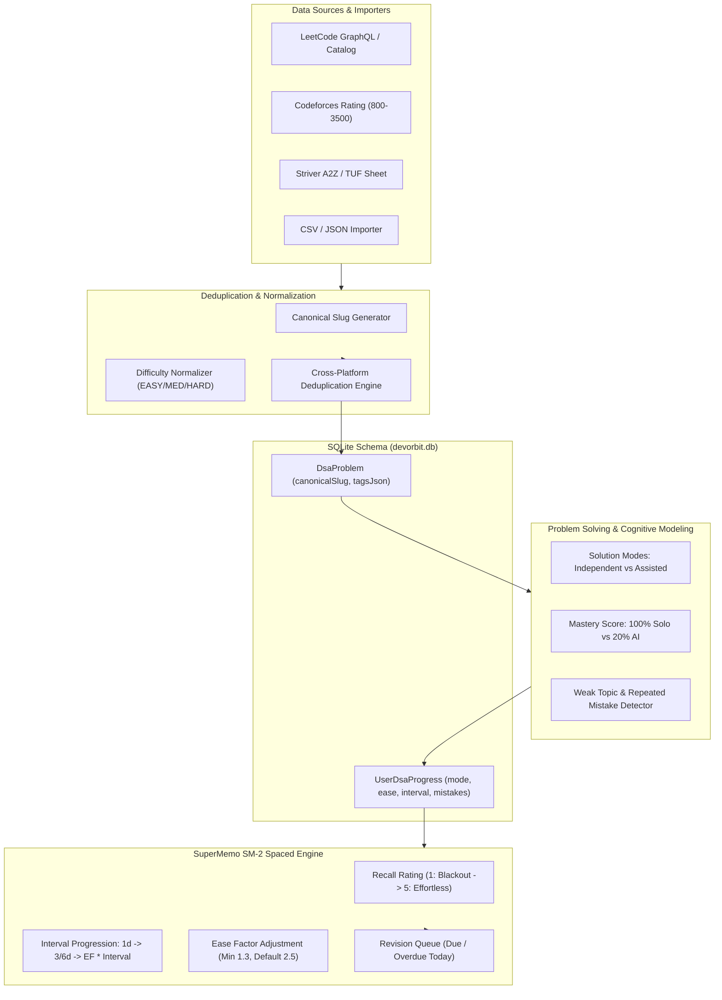

# DevOrbit — Advanced DSA Intelligence & Spaced Repetition (Milestone M3)

**Product:** DevOrbit — Local-first Developer Intelligence Operating System  
**Module:** DSA Intelligence Command Center  
**Version:** 1.0.0  
**Specification:** M3  

---

## 1. Architectural Overview

DevOrbit's DSA Intelligence Command Center moves beyond simple checkmark checklists. It introduces true solution mode classification, SuperMemo SM-2 transparent spaced repetition scheduling, cross-platform problem deduplication, and weakness-driven recommendation trees.

---

## 2. Solution Modes & True Mastery Index

Traditional platforms equate reading an editorial to independent mastery. DevOrbit explicitly categorizes attempts:

| Solution Mode | Mastery Score | Cognitive Implication |
|---|---|---|
| `INDEPENDENT` | **100.0%** | Full unassisted mastery; strong algorithmic recall |
| `REATTEMPTED` | **75.0%** | Solo solution achieved after prior difficulty or failure |
| `WITH_HINTS` | **65.0%** | Solved using conceptual or algorithmic hints |
| `WITH_EDITORIAL`| **35.0%** | Read reference solution before implementing |
| `WITH_AI` | **20.0%** | Generated code via LLM/AI assistant |
| `FAILED` | **0.0%** | Attempted but failed core test cases |

**Independent Mastery Score**:
$$\text{Average Mastery} = \frac{\sum \text{MasteryScore}(\text{problem})}{\text{Total Solved Problems}}$$

---

## 3. SuperMemo SM-2 Spaced Repetition Engine

Every problem solution or review records a recall quality rating $q \in \{1, 2, 3, 4, 5\}$:
- **5 (Perfect)**: Effortless immediate recall.
- **4 (Good)**: Correct response recalled with slight hesitation.
- **3 (Hard)**: Correct response recalled with serious effort.
- **2 (Struggled)**: Incorrect response; correct algorithm remembered upon seeing prompt.
- **1 (Blackout)**: Complete lack of recall; total concept loss.

### Interval Formula:
For $q \ge 3$:
- $I(0) = 1 \text{ day}$
- $I(1) = 6 \text{ days if } q = 5 \text{ else } 3 \text{ days}$
- $I(n) = \text{round}(I(n-1) \times EF)$

For $q < 3$:
- $n = 0$ (Reset repetition counter)
- $I = 1 \text{ day}$
- Status set to `REVISE`

### Ease Factor Adjustment:
$$EF' = \max(1.3, EF + (0.1 - (5 - q) \times (0.08 + (5 - q) \times 0.02)))$$

---

## 4. Cross-Platform Deduplication

When users import custom sheets (Striver A2Z, Blind 75, NeetCode 150) or solve across platforms, identical problems (e.g. "Two Sum" on LeetCode and "Two Sum" in Striver) are resolved through `generateCanonicalSlug(title)`:
- Strips problem numbers: `"1. Two Sum"` $\rightarrow$ `"two-sum"`.
- Normalizes punctuation and casing: `"15. 3Sum - Closest"` $\rightarrow$ `"3sum-closest"`.
- Prevents database duplication while maintaining source platform URLs.

---

## 5. Verification & Tests

Milestone M3 is verified through automated integration tests in `apps/api/src/tests/dsa_intelligence.test.ts`:
1. Canonical slug normalization and rating mapping.
2. CSV and JSON sheet import with deduplication against existing database entries.
3. Solution mode distinction (100% solo vs 65% hints).
4. SM-2 spaced repetition calculation (progression from 1 to 6 days; reset to 1 day on blackout).
5. Revision queue filtering for due/overdue items.
6. Repeated mistake tagging (`#off-by-one`, `#edge-case-empty`).
7. Personalized recommendation engine focusing on weak topics.
8. Multi-user isolation between User A (Alex) and User B (Sara).
