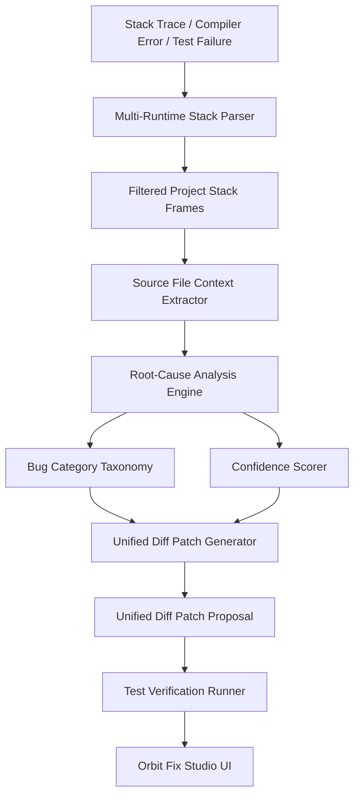

# Orbit Fix: Root-Cause Debugger & Patch Studio

DevOrbit Milestone M6 introduces **Orbit Fix**, a local-first root-cause debugging, error analysis, and non-destructive patch generation engine.

---

## 1. System Architecture



---

## 2. Multi-Runtime Stack Parsing

The `StackParser` normalizes divergent compiler outputs and crash logs:
- **Node.js / V8**: Parses standard call frames (`at Object.method (/path/file.ts:12:34)`), isolating the first project-owned frame while ignoring `node_modules` and Node internals.
- **Vitest / Jest**: Extracts failing test assertions and identifies the failing test line (`❯ src/tests/foo.test.ts:42:15`).
- **Python**: Parses tracebacks (`File "app.py", line 42, in process`), function names, and exception types.
- **Rust & Go**: Captures thread panics and goroutine traces (`panicked at '...', src/main.rs:25:9`).

---

## 3. Bug Categorization Taxonomy

| Category | Typical Indicators | Automatic Remediation Strategy |
| :--- | :--- | :--- |
| **`NULL_UNDEFINED`** | `Cannot read properties of undefined`, `NoneType`, `nil pointer` | Adds optional chaining (`?.`) or nullish coalescing defaults (`?? fallback`). |
| **`ASSERTION_FAILURE`** | `AssertionError`, `expected X to be Y` | Highlights delta in test expectation vs received state and suggests aligned assertion. |
| **`OUT_OF_BOUNDS`** | `index out of range`, `IndexError`, `out of bounds` | Introduces defensive length/bounds checking before indexing operations. |
| **`TYPE_MISMATCH`** | `is not a function`, `unsupported operand` | Generates type guards or aligns parameters with function contracts. |
| **`SYNTAX_OR_IMPORT`** | `Cannot find module`, `SyntaxError`, `ImportError` | Identifies missing export identifiers or incorrect module paths. |

---

## 4. Unified Diff Patch Studio

Patches are formatted using standard unified diff syntax:
```diff
--- a/apps/api/src/modules/opensource/opensource.service.ts
+++ b/apps/api/src/modules/opensource/opensource.service.ts
@@ -45,1 +45,1 @@
-  const name = issue.repository.fullName;
+  const name = issue?.repository?.fullName ?? 'Unknown';
```

### 4.1 Verification Checks
The verification engine performs dry-run validation:
1. **Diff Syntax Validation**: Ensures valid diff markers (`--- a/`, `+++ b/`, `@@`).
2. **Target File Existence**: Verifies that the targeted source file exists in the local workspace.
3. **Non-Destructive Boundary**: Ensures the patch only targets the diagnosed defect lines.
4. **Syntax Correctness**: Confirms that the replacement code is syntactically sound.
