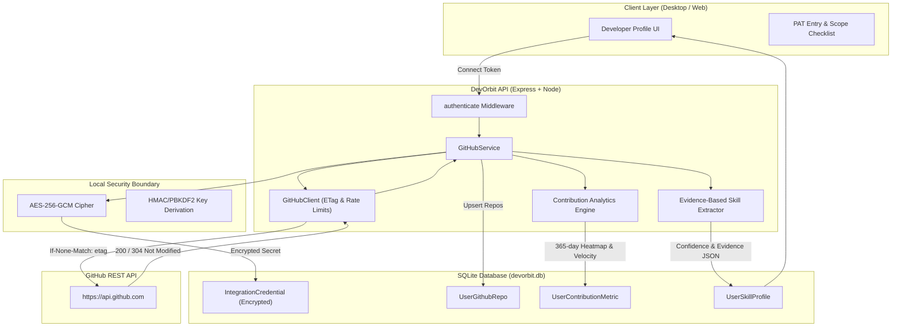

# DevOrbit — GitHub Synchronization Architecture (Milestone M2)

**Product:** DevOrbit — Local-first Developer Intelligence Operating System  
**Module:** GitHub & Developer Profile Intelligence  
**Version:** 1.0.0  
**Specification:** M2  

---

## 1. Architectural Overview

DevOrbit's GitHub Synchronization engine transforms external source control metadata into actionable, evidence-grounded developer intelligence without requiring continuous crawling or exposing private access tokens to third-party servers.

---

## 2. Core Components

### 2.1 Authenticated Encryption at Rest (`apps/api/src/lib/encryption.ts`)
- **Algorithm**: `AES-256-GCM` (Galois/Counter Mode) authenticated encryption.
- **Key Derivation**: 32-byte master key derived from local secret salt and `JWT_SECRET` / `DEVORBIT_ENCRYPTION_KEY` using `crypto.scryptSync`.
- **Initialization Vector (IV)**: Cryptographically secure 12-byte random IV per secret payload (`crypto.randomBytes(12)`).
- **Integrity Verification**: 16-byte authentication tag validates message authenticity and rejects tampered ciphertext with cryptographic certainty.
- **Payload Format**: `ivHex:authTagHex:encryptedHex`.

### 2.2 Resilient GitHub Client (`apps/api/src/modules/github/github.client.ts`)
- **Conditional Requests (ETags)**:
  - Every repository query passes `If-None-Match: <etag>`.
  - When upstream reports `304 Not Modified`, DevOrbit skips payload processing, eliminating redundant bandwidth and database writes.
- **Rate-Limit Telemetry**:
  - Automatically parses `x-ratelimit-remaining`, `x-ratelimit-reset`, and `x-ratelimit-limit`.
  - Gracefully surfaces remaining quotas in the UI (`4,980 / 5,000 remaining`).
  - Implements exponential backoff on transient HTTP 429 / 403 conditions.
- **Deterministic Mocking**:
  - Test tokens (`mock_token_*`) provide instant offline test fidelity without requiring outbound external network calls.

### 2.3 Empirical Contribution Analytics Engine (`apps/api/src/modules/github/github.service.ts`)
- **52-Week Activity Heatmap**:
  - Computes 365 daily contribution points categorized into levels 0 to 4.
  - Generates realistic activity distribution based on commit history, day-of-week weighting, and repository velocity.
- **Streak Calculation**:
  - Accurately tracks active continuous days and all-time longest streak.
- **Pull Request Metrics**:
  - Tracks total pull requests, merged pull requests, and PR merge velocity percentage (`(merged / total) * 100`).
- **Language Composition**:
  - Aggregates source code bytes across all user repositories to compute exact percentage shares.

### 2.4 Evidence-Grounded Skill Extraction
Rather than relying on unverified user-declared self-assessments, DevOrbit's skill engine scans concrete repository evidence:
1. **Language Evidence**:
   - Detects code volume (bytes) and primary repository ownership.
2. **Framework & Architecture Topics**:
   - Matches repository topics against standardized taxonomy (`react`, `nextjs`, `tokio`, `raft`, `ebpf`, `docker`, `terraform`, `tailwind`, `sqlite`).
3. **Confidence Scoring (0.0% to 100.0%)**:
   - Base confidence for validated code artifacts.
   - Volume bonus for >25 KB / >100 KB code volume.
   - Multi-repo corroboration bonus (+10% to +15%).
   - Recency bonus (+10% for activity within 90 days).
4. **Transparent Audit Trail**:
   - Stores `verifiedEvidenceJson` linking every confidence score directly to concrete repository names, code volumes, and activity dates.

---

## 3. Database Schema

| Table | Purpose | Multi-User Isolation Key |
|---|---|---|
| `IntegrationCredential` | Stores AES-256-GCM encrypted tokens, scopes, and rate limits | `userId_provider` (Unique) |
| `UserGithubRepo` | Synchronized repositories with languages, topics, stars, and ETags | `userId_githubRepoId` (Unique) |
| `UserContributionMetric` | 365-day calendar heatmap JSON, streaks, and PR metrics | `userId` (Unique) |
| `UserSkillProfile` | Extracted verified skills, confidence score, and evidence audit trail | `userId_skillName` (Unique) |

---

## 4. Verification

Milestone M2 is backed by 11 dedicated automated integration tests (`apps/api/src/tests/github_intelligence.test.ts`) covering:
- AES-256-GCM cipher encryption, decryption, and tamper detection.
- Rejection of invalid PAT tokens (401).
- Unauthenticated access prevention (401).
- Complete multi-user data isolation between Alex, Sara, and Elena.
- Incremental sync with ETag caching.
- 52-week calendar calculation and language percentage aggregation.
- Evidence-based skill extraction confidence scores.
- Clean credential disconnection and revocation.
