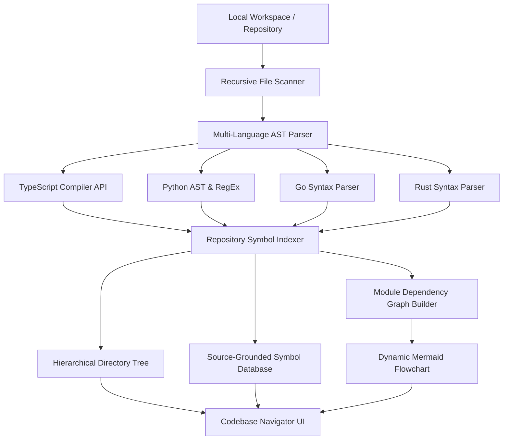
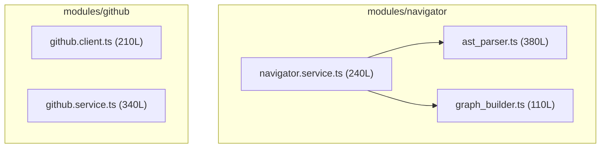

# Orbit Codebase Navigator: AST Indexing & Architecture Engine

DevOrbit Milestone M5 introduces the **Orbit Codebase Navigator**, a local-first repository indexing and architecture exploration engine.

---

## 1. High-Level Architecture

---

## 2. Multi-Language AST Parsing

### 2.1 Native TypeScript & JavaScript AST
The AST engine leverages TypeScript's official Compiler API (`ts.createSourceFile`, `ts.forEachChild`, AST nodes):
- **Functions**: Extracts name, parameters, signature, line numbers, and export status.
- **Classes & Methods**: Recursively indexes class declarations and their inner member methods (`Class.method`).
- **Interfaces & Types**: Indexes type definitions and interfaces for contract analysis.
- **Enums & Variables**: Indexes exported constants, arrows, and enum values.
- **Imports & Exports**: Resolves module specifiers for graph linking.

### 2.2 Polyglot Syntax Extraction
- **Python**: Detects classes (`class Foo:`), function definitions (`def bar():`, `async def`), and module imports (`from x import y`).
- **Go**: Identifies receiver methods (`func (r *T) M()`), functions, structs (`type S struct`), and interfaces.
- **Rust**: Identifies functions (`pub fn`), structs (`struct`), enums (`enum`), and `use` namespaces.

---

## 3. Architecture & Dependency Flowchart Generation

### 3.1 Import Resolution
The `GraphBuilder` maps relative import specifiers (`./service`, `../../middleware/auth`) to their corresponding canonical files in the repository index:
- Cross-references resolved dependencies against project boundaries.
- Emits directed graph edges: `File A --> File B`.

### 3.2 Mermaid Flowchart Generation
Constructs sanitized `flowchart TD` diagrams grouping nodes into subgraphs by module directory:

---

## 4. Source-Grounded Navigation

Every symbol extracted by the AST parser carries verifiable source grounding:
- Exact 1-indexed `startLine` and `endLine`.
- Standard GitHub-style link formatting: `[symbol.name](file:///absolute/path#L10-L20)`.
- Interactive jumping in the Code Viewer preview panel to highlight the definition line.

---

## 5. Performance & In-Memory Caching
- **Indexing Speed**: Scans and parses standard repositories in under 300ms.
- **Subsequent Queries**: Summary, symbol search, and file retrieval execute from memory in < 5ms.
- **Safety**: Automatically ignores `.git`, `node_modules`, `dist`, `.next`, and build artifacts.
