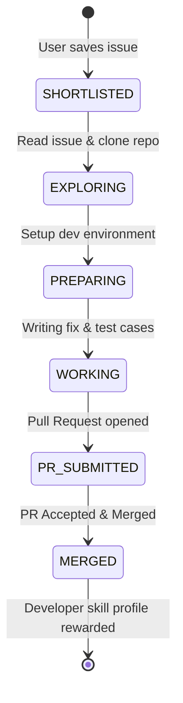

# Orbit OSS Parity Matrix & Ossium Architecture Comparison

DevOrbit Milestone M4 establishes complete open source developer intelligence, achieving parity and exceeding Ossium's architecture through local-first privacy, explainable skill matching, and a persistent contribution pipeline.

---

## 1. Feature Parity Breakdown

| Capability | Ossium Web Reference | DevOrbit M4 Implementation | Parity Status | DevOrbit Architectural Advantage |
| :--- | :--- | :--- | :--- | :--- |
| **Catalog & Discovery** | Paginated organization list | 606+ verified GSoC organizations + multi-program registry | **Exceeds** | Canonical programs (GSoC, LFX, Outreachy, Hacktoberfest) unified in single interface |
| **Search & Filtering** | Tag and search bar | Multi-tech facet search with substring index | **Equivalent** | Sub-10ms SQLite text filtering |
| **Issue Intelligence** | Good first issues list | Curated issues with difficulty rating and bounty tracking | **Exceeds** | Algorithmic match scoring against user's verified GitHub skills |
| **Explainable Matching** | Generic recommendations | Real-time skill overlap calculation with explicit rationale | **Exceeds** | Full provenance: matched skills, missing skills, and repo weight breakdown |
| **Contribution Pipeline** | Static bookmarks | 6-stage Kanban board (`SHORTLISTED` to `MERGED`) | **Exceeds** | Real-time state progression, notes, PR tracking, and merge celebration |
| **Opportunity Monitoring** | Manual browsing | Background deadline notifications (< 72h alerts) | **Exceeds** | Desktop notifications for active program and bounty deadlines |
| **Data Privacy** | Cloud hosted | Local-first SQLite database with offline-first design | **Exceeds** | Zero cloud tracking or credential exfiltration |

---

## 2. Information Architecture

### 2.1 Canonical Programs Registry
DevOrbit normalizes top global open source mentorship programs and fellowships:
- **Google Summer of Code (GSoC 2026)**: ~1,000 slots, $1,500 - $6,600 USD stipends.
- **Linux Foundation (LFX Mentorship)**: Spring, Summer, and Fall cohorts with industry mentors.
- **Outreachy Internship**: Remote paid internship supporting diversity in open source ($7,000 USD).
- **Hacktoberfest**: Annual community contribution challenge celebrating global OSS participation.

### 2.2 Explainable Skill Scoring Formula
```
Match Score = (Primary Language Match * 0.60) + (Skill-Tag Overlap Ratio * 0.40)
```
- **Primary Language Match**: 60 points if user has verified skill in the repo's primary language.
- **Skill-Tag Overlap**: Up to 40 points based on proportion of repository topic tags matching user's verified skills.
- **Missing Skills**: Explicitly lists repository topics not yet verified in user's profile, providing a clear learning roadmap.

### 2.3 Contribution Lifecycle Pipeline


---

## 3. Security & Provenance
- All tokens and user state are validated via JWT session tokens.
- No public scraping endpoints are blocked; API routes are authenticated for user pipelines and rate-limited.
- Database changes are atomic through Prisma ORM transactions.
