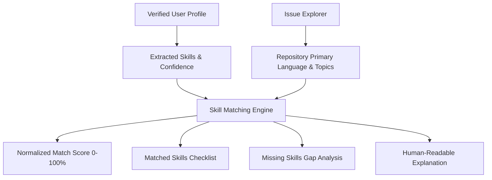

# Orbit OSS: Skill Matching Engine & Data Provenance

This document outlines the design and algorithmic foundation of the **Orbit OSS Intelligence Engine** implemented in DevOrbit Milestone M4.

---

## 1. Grounded Skill Matching Architecture

Unlike black-box recommendation systems, DevOrbit requires **Explainable Developer Intelligence**. When DevOrbit recommends an open-source issue, it must provide verifiable evidence detailing *why* the user is equipped to solve it.

---

## 2. Algorithmic Scoring Specification

### 2.1 Inputs
1. **User Verified Skills** $S_u = \{s_1, s_2, \dots, s_n\}$: Extracted from verified commits, repositories, and languages synced in Milestone M2.
2. **Issue Repository Context**:
   - Primary Language $L_{repo}$
   - Repository Topic Tags $T_{repo} = \{t_1, t_2, \dots, t_m\}$

### 2.2 Computation Rules
- **Base Match Weight**:
  If $\exists s \in S_u$ such that $\text{normalize}(s) = \text{normalize}(L_{repo})$, then:
  $$W_{lang} = 60$$
  Otherwise:
  $$W_{lang} = 0$$

- **Tag Overlap Weight**:
  Let $M = S_u \cap T_{repo}$ be the set of matched topics.
  If $|T_{repo}| > 0$, then:
  $$W_{tags} = 40 \times \frac{|M|}{|T_{repo}|}$$
  Otherwise (if no topics tagged), and $W_{lang} > 0$:
  $$W_{tags} = 25$$

- **Total Normalized Score**:
  $$\text{Score} = \min(100, \text{round}(W_{lang} + W_{tags}))$$

### 2.3 Transparent Evidence Generation
The engine produces:
- `matchedSkills`: Array of verified skills found in repository topics or language.
- `missingSkills`: Array of topic tags in the repository not present in the user's verified profile.
- `repositoryMatch`: Boolean indicating whether the user possesses proficiency in the primary repository language.
- `explanation`: Clear string summarizing why this task fits the developer's background (e.g. *"Strong match: Your verified TypeScript proficiency aligns with this repository. You also have verified skills in react and tailwind."*).

---

## 3. Contribution Pipeline (Kanban Lifecycle)

To eliminate the friction of losing track of shortlisted issues, DevOrbit provides a native 6-stage lifecycle:

1. **`SHORTLISTED`**: User has flagged the issue for future exploration.
2. **`EXPLORING`**: User is examining the codebase, reading documentation, and cloning the project.
3. **`PREPARING`**: User is replicating the issue locally and setting up test cases.
4. **`WORKING`**: Active development of the patch or feature.
5. **`PR_SUBMITTED`**: Pull request submitted upstream with link recorded.
6. **`MERGED`**: Upstream project has merged the pull request. Triggers celebratory alert and increments user's verified OSS contribution portfolio.

---

## 4. Opportunity & Deadline Monitoring

The `monitorOpportunities` endpoint scans all canonical programs:
- Identifies programs with `applicationEnd` within 72 hours.
- Dispatches high-priority notification to the user's desktop dashboard.
- Ensures developers never miss GSoC, LFX Mentorship, or Hacktoberfest submission deadlines.
