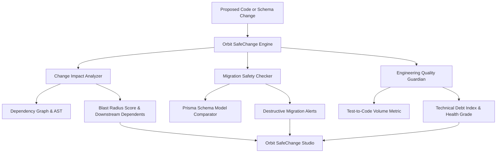

# Orbit SafeChange: Change Impact & Engineering Quality Guardian

DevOrbit Milestone M7 introduces **Orbit SafeChange**, a local-first engineering quality system providing ripple change impact analysis, non-destructive migration safety checks, and dependency health guardianship.

---

## 1. High-Level Architecture

---

## 2. Change Impact & Blast Radius Scoring

### 2.1 Graph Ripple Traversal
Given any modified file (e.g. `apps/api/src/lib/jwt.ts`), the analyzer traverses the project dependency graph generated in Milestone M5:
- **Direct Dependents**: Files that import the target file directly.
- **Transitive Dependents**: Files that import the direct dependents.
- **Affected Endpoints**: Controller and route files caught in the ripple tree.
- **Impacted Test Suites**: Specific `*.test.ts` suites that must be executed to verify backward compatibility.

### 2.2 Risk Level Formula
$$\text{Risk Score} = 15 + (\text{isCoreUtility} \times 45) + (|\text{Dependents}| \times 8) + (|\text{Routes}| \times 10) + (|\text{Tests}| \times 5)$$
- **`LOW` (0-29)**: Isolated leaf modules or scripts with no downstream dependents.
- **`MEDIUM` (30-49)**: Feature services affecting internal callers.
- **`HIGH` (50-74)**: Core modules affecting multiple public API endpoints.
- **`CRITICAL` (75-100)**: Foundational security, middleware, or database schema changes requiring regression auditing.

---

## 3. Migration Safety & Anti-Destruction Rules

The `MigrationSafetyChecker` prevents accidental schema loss before migrations are applied:
1. **Dropped Models**: Flags removed `model Foo` definitions that would drop tables and destroy records.
2. **Dropped Fields**: Flags deleted columns where data loss would occur.
3. **Non-Nullable Field Additions Without Default**: Flags non-nullable columns added to existing tables lacking `@default(...)` or `@id`, which fail migrations on populated SQLite/PostgreSQL databases with `NOT NULL constraint failed`.
4. **Safety Score**: Produces a safety score from 0 to 100 with actionable safe remediation advice.

---

## 4. Engineering Quality Guardian

- **Test-to-Code Ratio**: Evaluates lines of automated tests vs lines of source code.
- **Health Grade**:
  - `A+`: Tech Debt Index $\le 15$, Test-to-Code Ratio $\ge 30\%$.
  - `A`: Tech Debt Index $\le 25$.
  - `B`: Tech Debt Index $\le 40$.
- **Dependency Guardian**: Monitors package inventory for licenses and stability.
