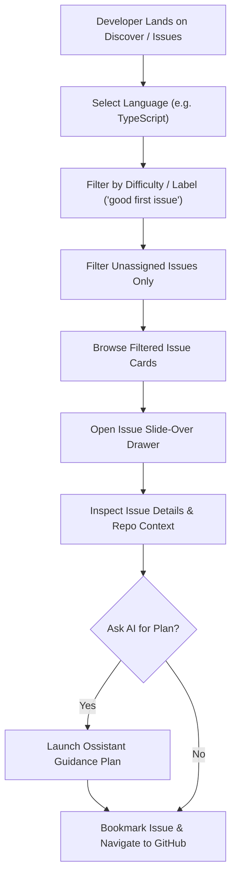
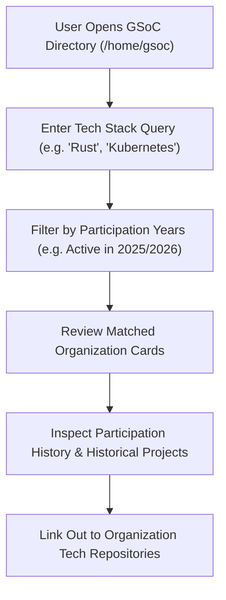
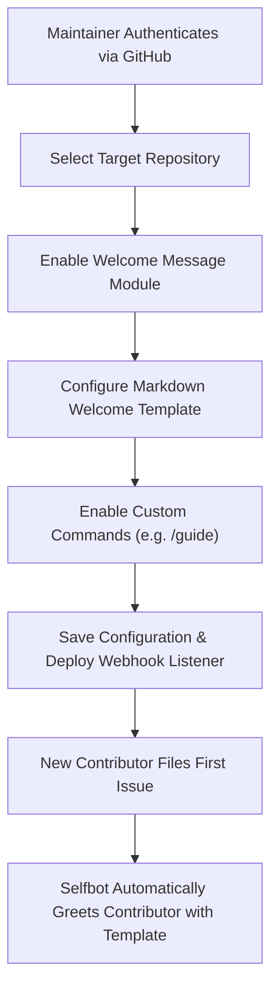

# Ossium Deep Reverse Engineering: Workflow Diagrams

This document illustrates the primary user and system workflows discovered in Ossium.

---

## 1. Open Source Issue Discovery & Picking Workflow

---

## 2. GSoC Organization Exploration Workflow

---

## 3. GitHub Selfbot Maintenance Workflow

